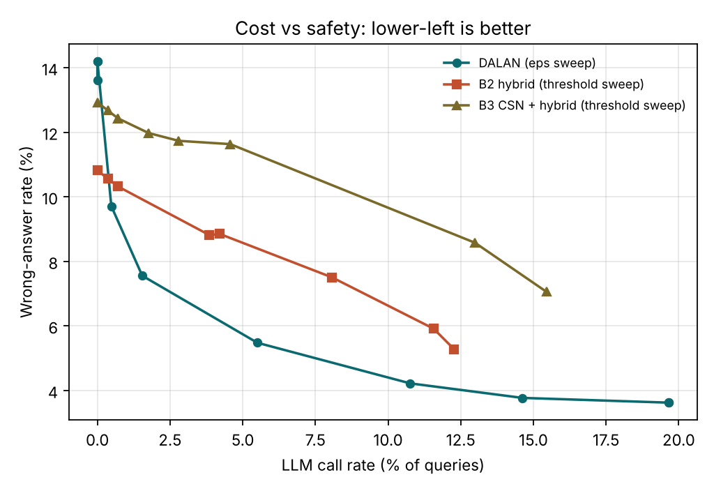

# PoultryBot (JuanGPT)

A fast, low-cost assistant for small and medium poultry raisers in the Philippines. It answers questions about broilers, layers, native and free-range chickens, ducks, and quail in English, Cebuano, Tagalog, and mixes of them. It runs on modest hardware with a small local LLM, and most answers never call the LLM.

It uses DALAN (Dual-channel Agreement with Lexicon-Augmented Normalization), the routing algorithm first built for the Sugbo Guide tourism bot ([kgorro/Dalan](https://github.com/kgorro/Dalan)). Here it is adapted to poultry with a new knowledge base, a Cebuano and Tagalog poultry lexicon, and a held-out test set. See [docs/METHOD.md](docs/METHOD.md).

## What it covers

77 verified topics in 13 groups: health and diseases (18), local research (14), layers (9), business (6), housing (4), feed and water (4), incubation (4), broilers (4), chicks and brooding (3), ducks and quail (3), eggs and meat safety (3), native and free-range (2), and getting started (2).

The local research group comes from four Cebu and Bantayan Island studies, kept as markdown knowledge packs in [kb/sources/](kb/sources/):
- Layer manure management on Bantayan Island (Ybañez et al., Asian Journal of Agriculture, in press)
- Gastrointestinal parasites in Bantayan layers (Destajo, Ybañez et al., Open Veterinary Journal, accepted)
- Newcastle, IB, and Gumboro antibody profile of Bantayan layers (Ybañez et al., Open Veterinary Journal, accepted)
- Production, health, and biosecurity profile of Cebu layer farms (Ybañez et al., Brazilian Journal of Poultry Science 2026)

Every research answer ends with its citation.

Safety rules built into the content and the LLM prompt:
- No drug or vaccine doses. Answers point to the product label and a licensed veterinarian.
- Newcastle disease and avian influenza are treated as reportable, with instructions to stop bird movement and call the veterinary office.
- Figures are typical ranges for guidance. Strain guides and suppliers come first.

## How a question is answered

1. Exact cache: a known or repeated question returns in under 1 ms. The prebuilt dump (below) already holds about 560 routed answers, and every answer the LLM writes is saved to disk so it is paid for once.
2. DALAN router (about 1 ms, no neural model):
   - Code-switch normalization reduces Cebuano and Tagalog word forms (mangitlog, gitambalan, bumili, nagsisimula, nag-drop) to lexicon roots and adds English farm terms.
   - Lexical and character n-gram retrieval, fused by reciprocal rank.
   - A logistic calibrator estimates the chance the top topic is right.
   - Per-language thresholds decide: skip (verified answer, no LLM), generate (local LLM answers from the top 3 topics only), or abstain (decline and point to help).
3. If the LLM is offline on an uncertain question, the bot shows the closest topic, says it is not sure, and lists related topics.

## Results

Two query sets were written before tuning: a development set for tuning and cross-validation, and a held-out test set (147 queries) used once at the end. The development set grew from 285 to 327 queries when the research packs were added (42 questions on the new topics); the test set is unchanged. Both mix English, Cebuano, Tagalog, code-switched text, and out-of-domain questions such as pig, fish, and human medicine. Full tables are in [results/results.md](results/results.md).

| Method | Dev CV accuracy | Dev CV wrong | Test accuracy | Test wrong | Test LLM calls |
|---|---|---|---|---|---|
| Always-RAG (LLM for every query) | 61.4% | 17.4% | 57.6% | 19.1% | 100% |
| Fixed-threshold lexical router | 58.2% | 11.8% | 49.5% | 21.7% | 2.0% |
| Normalization + fixed thresholds | 88.5% | 11.5% | 75.3% | 24.2% | 1.4% |
| DALAN without character channel | 89.2% | 6.0% | 81.6% | 9.5% | 16.3% |
| **DALAN (full)** | **89.7%** | **5.9%** | **75.9%** | **15.7%** | **4.8%** |

What the held-out test shows:
- Code-switch normalization matters most. On test, accuracy on Cebuano queries rose from 11% to 71%, and on Tagalog from 20% to 74%, over the fixed lexical router.
- DALAN generalized worse than cross-validation suggested. Top-1 retrieval fell from 92% on dev, which the keywords and lexicon were tuned on, to 85% on test. The calibrator learned its confidence from that tuned data, so it skipped too often on new phrasings: 15.0% of test answers were confident wrong answers.
- On test, removing the character channel gave fewer wrong answers (9.5% vs 15.7%) at the cost of more LLM calls. That ablation was not chosen in advance, so treat it as a lead to confirm, not a result.
- The lesson for deployment: tune keywords and the lexicon on one set of queries, and fit the calibrator on a separate set that tuning never saw.

- Adding the research packs left top-1 retrieval on the original test set unchanged (the scope gate below keeps them out of everyday questions). Test accuracy went from 77.7% to 75.9% and wrong answers from 14.4% to 15.7% because the 42 new dev questions are easy and made the calibrator more confident. The thresholds were not retuned on the test set to win this back.
- On 16 separate questions about the research topics (data/test_research.jsonl), the right entry was first for 69% and in the top 3 for 94%. Most misses pick a sibling finding from the same study, so research answers also list the related findings.

These numbers come from developer-written queries and an assumed LLM accuracy (90% when the right topic is in context). Real farmer questions are needed before any claim about field performance.

## Repository layout

    kb/build_kb.py          Knowledge base source (63 general topics). Run it to regenerate kb/kb.json
    kb/sources/*.md         Markdown knowledge packs (local research, 14 topics), read by kb/ingest_md.py
    kb/system_prompt.txt    LLM system prompt, shared by the backend and the fine-tuning export
    dalan/                  DALAN router: normalize.py, lexicon.py (305 Cebuano and Tagalog lemmas),
                            channels.py, calibrate.py, router.py, export.py (model for the browser),
                            dump.py (prebuilt knowledge dump for the backend)
    dist/                   The dump: router.pkl, answer_cache.json, manifest.json,
                            poultrybot_knowledge.md, finetune_chat.jsonl
    data/build_queries.py   Builds data/dev.jsonl, data/test.jsonl, and data/test_research.jsonl
    experiments/            run_experiments.py: dev cross-validation, baselines, ablations, Pareto sweep,
                            and the single held-out test evaluation with bootstrap confidence intervals
    results/                Generated tables and charts
    backend/app.py          FastAPI server: cache, DALAN, local LLM, safety note, Messenger webhook
    web/                    Browser demo: dalan.js (JavaScript port), page.html, build_page.py,
                            poultrybot.html (self-contained, opens directly)
    tests/                  test_dalan.py (unit and safety checks), test_parity.py (Python vs JavaScript)

## Quick start

    python -m venv .venv && source .venv/bin/activate      (Windows: .venv\Scripts\activate)
    pip install -r backend/requirements.txt

    python tests/test_dalan.py                  # unit and safety tests
    python tests/test_parity.py                 # browser router matches Python on all 498 queries (needs Node.js)
    python experiments/run_experiments.py       # reproduces results/

Run the bot with a local model (Ollama shown; llama.cpp and vLLM work through their OpenAI-compatible endpoints):

    ollama pull qwen2.5:7b-instruct             # check for newer small multilingual models first
    cd backend && uvicorn app:app --port 8000
    curl -X POST localhost:8000/chat -H "Content-Type: application/json" -d '{"question":"Nganong naay dugo ang iti sa akong manok?"}'

Environment variables: DALAN_EPS (error budget for verified answers, default 0.05; lower is more cautious), LLM_BASE_URL, LLM_MODEL, FB_VERIFY_TOKEN and FB_PAGE_TOKEN for Messenger.

Open web/poultrybot.html in a browser for the demo, no server needed. After changing the knowledge base, lexicon, or queries, rebuild it:

    python kb/build_kb.py && python data/build_queries.py
    python -m dalan.export && python web/build_page.py
    python -m dalan.dump                        # refresh the backend dump

## Deploying with Docker

    git clone https://github.com/kgorro/PoultryBot.git ~/poultrybot && cd ~/poultrybot
    cp .env.example .env && bash deploy/install.sh

This runs the bot and a local LLM (Ollama) with Docker Compose, with optional HTTPS through Caddy. Sizing, domain setup, and updates: [docs/DEPLOY.md](docs/DEPLOY.md).

## Adding knowledge from papers or extension materials

Write a markdown pack in kb/sources/ (format in [kb/sources/README.md](kb/sources/README.md)): one `##` section per topic with keywords, sample questions in English, Cebuano, and Tagalog, and the answer. Then run `python kb/build_kb.py` and `python -m dalan.dump`.

This is retrieval, not training. The LLM is never fine-tuned on the packs; the router finds the right section and either returns it as written or hands it to the LLM as context. That keeps answers exact (percentages, sources), lets you fix a fact by editing one line, and needs no GPU. dist/finetune_chat.jsonl and dist/poultrybot_knowledge.md are exported in case you later want to fine-tune a local model or paste the whole KB into a system prompt, but neither is needed to run the bot.

Packs carry a scope gate: their entries are only ranked when the question names a place or the research itself (Bantayan, Cebu, study, survey, antibody...). Without it, a survey entry that mentions bakuna or bitok outranked the general vaccination and worm topics on everyday questions. Words that occur only in gated entries are weighted separately, so adding a pack never changes how existing topics rank.

## Knowledge dump for fast local use

`python -m dalan.dump` writes dist/ with everything precomputed:
- router.pkl: the fitted router, so the backend starts in milliseconds instead of refitting
- answer_cache.json: every known question (KB sample questions and all query sets) already routed
- manifest.json: hashes of the KB, queries, prompt, and router code; if any changed, the backend refits rather than serve stale answers
- dist/llm_answers.jsonl (created at run time): answers the LLM wrote, reloaded at startup

A cached question costs a dictionary lookup (about 0.03 ms); an uncached one about 1 to 2 ms of routing; only the uncertain few call the LLM. GET /health reports whether the dump was used. Only load router.pkl files you built yourself, since pickle files can run code.

## Before using with farmers

- Have a poultry veterinarian or DA extension officer review every topic, especially vaccination schedules and disease entries.
- Collect real farmer questions (Messenger logs, extension office FAQs), label them with two annotators, and split them into tuning, calibration, and test sets.
- Run the local LLM on those questions to measure answer quality instead of assuming it.
- Add contact details for the local agriculture and veterinary offices in each deployment area.
- Three of the four research packs come from accepted or in-press manuscripts. Confirm with the authors and journals before a public deployment, and update the packs if figures change in the final versions.

## Author

Ken D. Gorro, Center for Cloud Computing, Big Data and Artificial Intelligence, Cebu Technological University, Carmen Campus.
